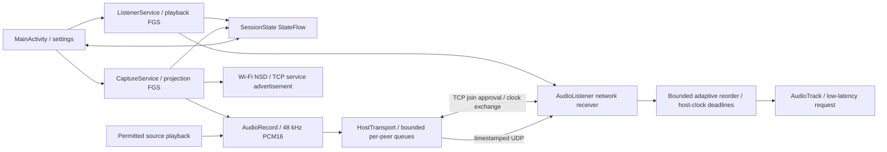

# Architecture and baseline

The real-device-tested Phase 2 baseline is commit `1322c68`. An exact archive is
preserved outside the source tree at `/tmp/wifi-audio-tools/phase2-baseline.tar`.
Use the Git commit for durable recovery; the archive is temporary.

## Audited Phase 2 pipeline

Single `app` module, Android 10–15 (min 29, target/compile 35), Kotlin 2.2.21,
AGP 8.13.2, Gradle 8.13, Java bytecode 17. Host requests RECORD_AUDIO then
MediaProjection consent. CaptureService starts a mediaProjection foreground
service and uses AudioPlaybackCaptureConfiguration for MEDIA/GAME/UNKNOWN.
AudioRecord reads 48 kHz mono PCM16, 480 samples per packet. UDP port 39555
accepts JOIN/LEAVE_WIFI_AUDIO_V1 heartbeats. Datagrams carry a big-endian uint32
sequence followed by 960 little-endian PCM bytes. Host expires peers after 6 s.
AudioListener plays directly into AudioTrack with at least 19,200 bytes (~200 ms)
of capacity. Network receive and blocking playback share a thread; kernel and
AudioTrack queues can accumulate delay. Listener dies with MainActivity.
There is no baseline latency recording; the only measured evidence supplied is
the user's successful two-phone test and audible slight listener delay.

## Phase gates

For each phase run unit tests and assembleDebug before the next phase. Preserve
the exact Phase 2 wire mode as an explicit fallback. Physical discovery timing,
speaker latency, lock-screen behavior and 15-minute stability cannot be proven
with a desktop build; record these as pending rather than fabricate results.

## Current architecture (Phases 3–5)

| Responsibility | Source |
|---|---|
| Capture consent, packet capture timestamps, lifecycle, host notification | CaptureService.kt |
| Wi-Fi NSD advertise/browse, serialized resolution, stale removal | SessionDiscovery.kt |
| Control handshake, capacity, independent 8-packet senders | HostTransport.kt |
| Approval timeout, bounded pending requests, explicit accept/decline | ApprovalGate.kt |
| Packet encoding/bounds and bounded control parsing | AudioPacket.kt, ControlProtocol.kt |
| Offset/RTT estimate, reorder/drop/insert/deadline strategy | ClockSync.kt, JitterBuffer.kt |
| Receiver/control/playout coroutine scope and diagnostics | AudioListener.kt |
| Foreground playback, focus/noisy routes, listener notification | ListenerService.kt |
| Preserved Phase 2 wire/playback behavior | LegacyAudioListener.kt, HostTransport legacy mode |
| Notification actions, Wi-Fi route binding, session CPU/Wi-Fi locks | ServiceSupport.kt |
| Ephemeral state and native day/night screens | SessionState.kt, MainActivity.kt, res/ |

Each service owns its resources. App/activity recreation does not own or stop
streaming. Closing a session cancels its scope and closes blocking sockets;
AudioRecord is stopped and released only when its capture job completes. No
sticky service or consent reuse is used. Every capture start needs fresh Android
consent. Focus is requested only by the listener so the host does not mute the
source application. Wi-Fi loss stops sessions rather than replay cached audio.

Most work uses scoped IO coroutines with bounded channels; the explicit V1
comparison listener retains its original worker thread and wire path. Android NSD
callbacks/UI are serialized on main. Normal control and audio bind to Wi-Fi when
available (important when cellular has the default internet route). Host listeners
are restricted to local private/link-local addresses. No cloud service exists.
